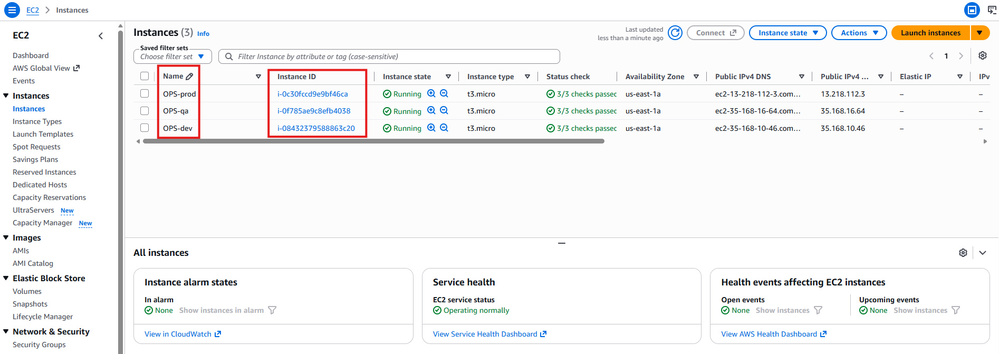
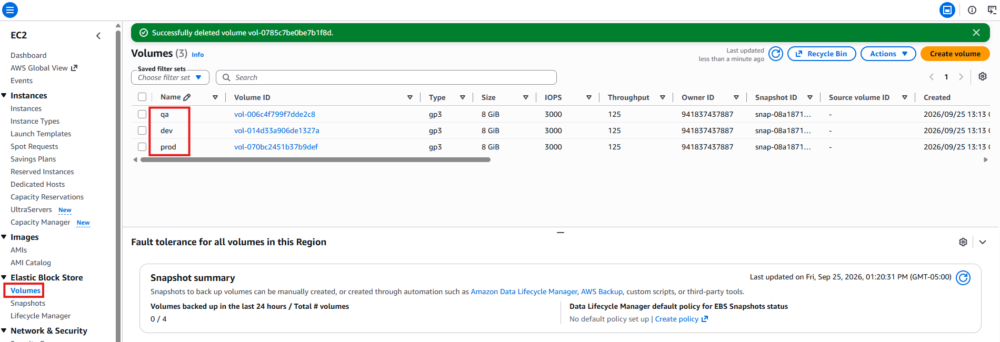
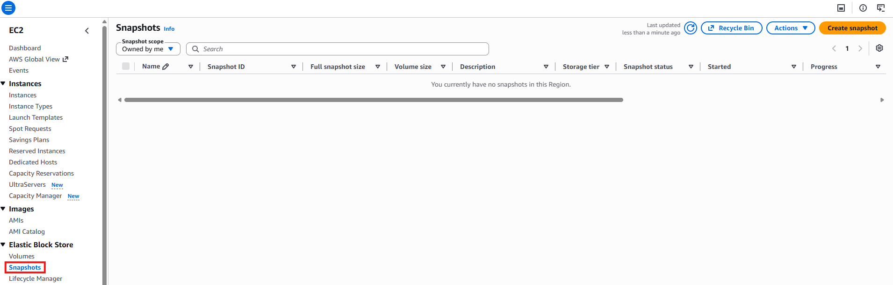
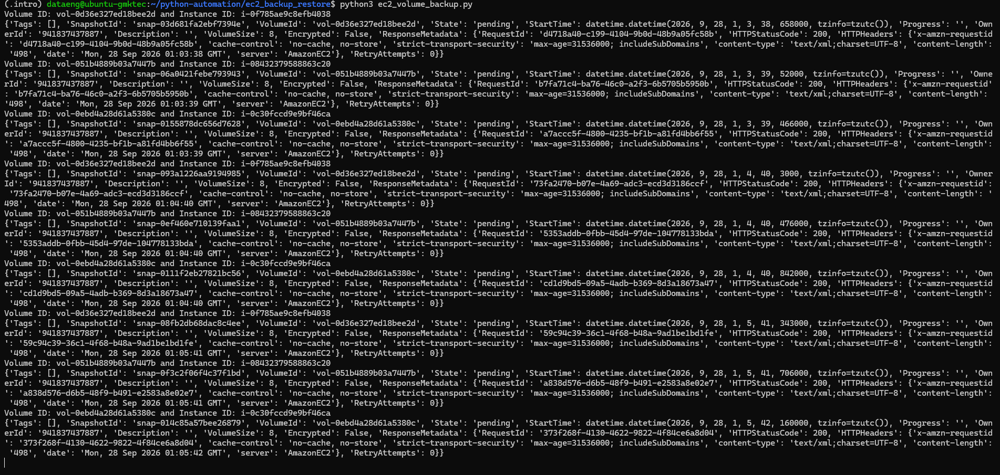
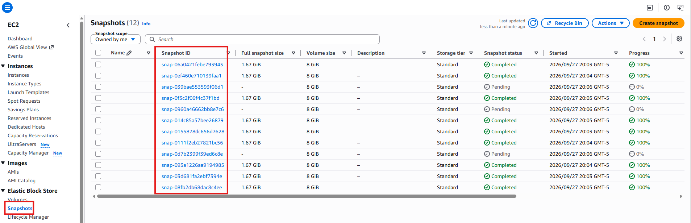
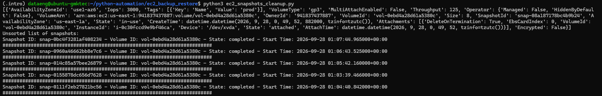
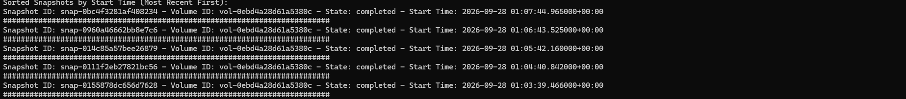
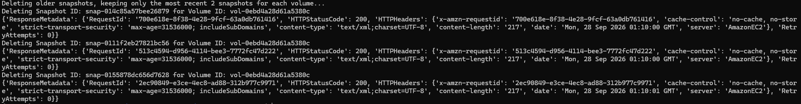
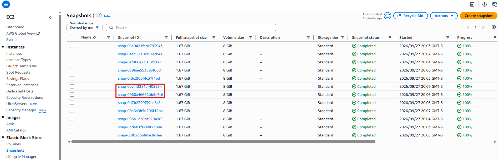

# EC2 Data Backup and Restore

## Overview

This project demonstrates how to automate Amazon EC2 volume backup, retention, and restoration activities using Python and the AWS SDK for Python (Boto3). Using Terraform, we will provision multiple EC2 instances and associated EBS volumes, create automated snapshots, implement a snapshot retention policy, and restore volumes from the most recent backup.

The solution mimics common enterprise backup and disaster recovery workflows while introducing key AWS automation concepts such as infrastructure provisioning, snapshot management, scheduling, and volume restoration.

## Technologies used
* Python
* Boto3
* AWS EC2
* Terraform

## Project Description
* Provision AWS infrastructure using Terraform.
* Automate EBS snapshot creation for EC2 volumes.
* Implement a snapshot retention policy that removes old backups.
* Restore EBS volumes from the latest available snapshot.
* Attach restored volumes to running EC2 instances.

## Pre-requisites

Before beginning this project, ensure the following requirements are met:

### AWS Requirements
* AWS Account
* IAM User or Role with permissions to:
  - Create and manage EC2 instances
  - Create and manage EBS volumes
  - Create and delete EBS snapshots
  - Attach EBS volumes to EC2 instances

### Software Requirements
* Terraform installed
* Python 3.x installed
* AWS CLI installed and configured
* Python Packages

### Python Packages
Install the required python libraries 
```
  python -m venv .venv
  source ~/.venv/bin/activate
  pip3 install boto3 schedule
```

### Configure AWS Credentials
Verify that your AWS credentials are configured:
```
  aws configure
```

Verify access to AWS:
```
  aws sts get-caller-identity
```

## Steps

### 1. Create AWS infrastructure using Terraform

Using Terraform, we will create three EC2 instances with attached EBS volumes.
The volumes will be assigned the following Name tags:
* prod
* qa
* dev

Define terraform.tfvars file
```
  vpc_cidr_block = DESIRED_VPC_CIDR_BLOCK
  subnet_cidr_block = SUBNET_CIDR_BLOCK
  avail_zone = AVAIL_ZONE
  env_prefix = DESIRED_PREFIX
  my_ip = IP_ADDRESS 
  instance_type = DESIRED_INSTANCE_TYPE
  public_key_location = PUBLIC_KEY_FILE_LOCATION
  image_name = "al2023-ami-2023*"
```

Initialize Terraform
```
  terraform init
```

Review the execution plan
```
  terraform plan
```

Deploy the infrastructure
```
  terraform apply
```

#### EC2 Instances console: 


#### Newly created EBS Volumes:


### 2. Create Snapshots from volumes attached to EC2 Instances
Before executing the script **ec2_volume_backup.py**,  verify that no snapshots currently exist.

#### EBS Snapshots Console


Execute the backup script:
```
  python3 ec2_volume_backup.py
```

The script will perform the following actions:
1. Retrieves all EBS volumes in the AWS account.
2. Iterates through each volume.
3. Creates a new snapshot for every volume discovered.
4. Prints the snapshot creation response.
5. Executes automatically every minute using the Python Schedule library. ec2_volume_backup



After several minutes, additional snapshots should appear in the AWS console.



**Note:** The one-minute interval is intended only for demonstration purposes. Production environments typically schedule backups hourly, daily, or according to organizational recovery objectives.

### 3. Remove old snapshots and retain the latest two copies
The script **ec2_snapshots_cleanup.py** retains only the two most recent snapshots for volumes tagged as **prod** and deletes all older snapshots. 

Execute the script:
```
  python3 ec2_snapshots_cleanup.py
```
The script will do the following:
1. Retrieves volumes with the Name tag value prod.
2. Retrieves snapshots associated with each matching volume.
3. Displays an unsorted list of snapshots.
4. Sorts snapshots by the StartTime attribute in descending order (newest first).
5. Displays the sorted snapshot list.
6. Retains the two newest snapshots.
7. Deletes all remaining older snapshots.

Unsorted Snapshot List


Sorted Snapshot List



Snapshot Deletion Output



AWS Console Showing Only Two Remaining Snapshots for the Prod volume. Please note that the script did not delete any snapshots for both 'qa' and 'dev' volumes. 



### 4. Restore a volume From the latest snapshot

Replace the value of the instance_id variable in the script with the target EC2 instance ID before running the restore operation - **ec2_restore_volume_snapshot.py**

Execute the script:
```
  python3 ec2_restore_volume_snapshot.py
```

The script **ec2_restore_volume_snapshot.py** will perform the following actions:
1. Retrieves all volumes attached to the specified EC2 instance.
2. Selects the first attached volume.
3. Retrieves all snapshots associated with that volume.
4. Sorts snapshots by StartTime in descending order.
5. Selects the most recent snapshot.
6. Creates a new EBS volume from the latest snapshot.
7. Appends the suffix-restored to the new volume's Name tag.
8. Waits until the new volume becomes available.
9. Attaches the restored volume to the EC2 instance as /dev/xvdb

INSERT SCREENSHOT

Volume Creation Process

INSERT SCREENSHOT

New Restored Volume

INSERT SCREENSHOT

Restored Volume Attached to EC2 Instance


## Learning outcomes

By completing this project, you will learn how to:

* Provision AWS infrastructure using Terraform.
* Create and manage EBS volumes attached to EC2 instances.
* Use Boto3 to interact with AWS services programmatically.
* Automate EBS snapshot creation using Python.
* Implement snapshot retention policies to reduce storage costs.
* Sort AWS resources using Python lambda functions and list operations.
* Restore EBS volumes from snapshots.
* Attach restored volumes to running EC2 instances.
* Build foundational disaster recovery and backup automation workflows.
* Apply Infrastructure as Code (IaC) and automation principles in AWS environments.
