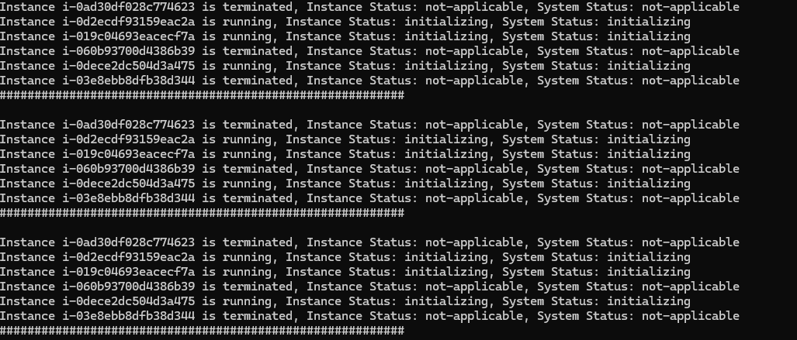

# Health Check: EC2 Status Checks

## Overview
This project demonstrates how to monitor the health and status of Amazon EC2 instances using Python and the AWS SDK for Python (Boto3). Infrastructure is provisioned using Terraform, which creates three EC2 instances within AWS. A Python script then retrieves the instance state and status check information directly from AWS and displays the results in the console.

The project is extended to perform continuous health monitoring by periodically checking EC2 instance statuses at configurable intervals. This provides hands-on experience with infrastructure automation, cloud resource monitoring, and integration between Terraform and Python.


## Technologies Used
* Python
* Boto3
* AWS
* Terraform

## Project Description
* Create 3 EC2 Instances with Terraform
* Write a Python script that fetches statuses of EC2 Instances and prints to the console
* Extend the Python script to continuously check the status of EC2 Instances in a specific interval

## Pre-requisites
Before starting this project, ensure you have the following:
* An AWS account
* AWS CLI installed and configured with appropriate credentials
* Terraform installed
* Python 3 installed
* Boto3 Python package installed
* An SSH key pair for EC2 access
* IAM permissions to create and manage:
  -  VPCs
  -  Subnets
  -  Security Groups
  -  EC2 Instances
* Basic understanding of:
  - Terraform
  - Python
  - AWS EC2

Install the required Python dependency
```
  python -m venv .venv
  source ~/.venv/bin/activate
  pip3 install boto3
```

Verify AWS authentication
```
  aws sts get-caller-identity
```

Verify Terraform Installation
```
  terraform version
```

## Steps

### 1. Create and define terraform.tvars file
Define terraform.tvars file before running terraform
```
  vpc_cidr_block = DESIRED_VPC_CIDR_BLOCK
  subnet_cidr_block = SUBNET_CIDR_BLOCK
  avail_zone = AVAIL_ZONE
  env_prefix = DESIRED_PREFIX
  my_ip = IP_ADDRESS 
  instance_type = DESIRED_INSTANCE_TYPE
  public_key_location = PUBLIC_KEY_FILE_LOCATION
  image_name = "al2023-ami-2023*"
```
Make sure that you add terraform.tvars in .gitignore file

### 2. Create the EC2 Instances 
```
  terraform init
  terraform plan
  terraform apply
```
### 3. Run main.py to see the status of 3 newly created EC2 instances
```
  python3 main.py
```


### 4. Destroy infrastructure using Terraform
```
  terraform destroy
```

## Learning Outcomes
By completing this project, you will learn how to:
* Provision AWS infrastructure using Terraform
* Create and manage EC2 instances programmatically
* Configure Terraform variables using a separate terraform.tfvars file
* Authenticate to AWS using the AWS CLI and SDKs
* Use the Boto3 library to interact with AWS services
* Retrieve EC2 instance state information using Python
* Perform EC2 status and health checks programmatically
* Implement continuous monitoring with Python loops and time-based intervals
* Automate cloud infrastructure validation tasks
* Follow Infrastructure as Code (IaC) best practices by separating configuration from source code
* Protect sensitive configuration data by excluding terraform.tfvars from version control
