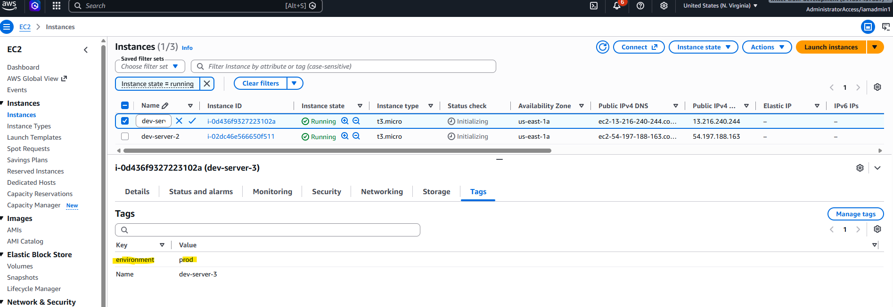

# Automate configuring EC2 Server instances

## Overview
This project demonstrates how to automate AWS EC2 resource tagging using Python and the AWS SDK for Python (Boto3). Infrastructure is provisioned using Terraform, which creates the EC2 instances that will be managed by the automation script. After the infrastructure is deployed, a Python script discovers all EC2 instances within a specified AWS region and automatically applies a standardized environment tag. 

Automating resource tagging helps organizations improve cloud governance, cost allocation, resource management, automation, and operational visibility. By leveraging Boto3, cloud administrators can efficiently enforce tagging standards across existing and newly deployed infrastructure without manual intervention.


## Technologies used
* Python
* Boto3
* AWS

## Project Description
* Create EC2 instances using Terraform
* Write a Python script that retrieves all EC2 instances in a specified AWS region
* Automatically add environment tags to the discovered EC2 instances
* Verify the tags using the AWS Console or AWS CLI
  
## Pre-requisites
Before starting this project, ensure you have the following:
* An AWS account
* AWS CLI installed and configured
* Python 3 installed
* Boto3 installed
* IAM permissions to:
  - Describe EC2 instances
  - Create and manage EC2 tags
* One or more EC2 instances running in your AWS account
* Basic understanding of:
  - AWS EC2
  - Resource tagging
  - Python scripting

Install the required Python dependencies
```
  python -m venv .venv
  source ~/.venv/bin/activate
  pip3 install boto3  
```

Verify AWS authentication
```
  aws sts get-caller-identity
```

Verify Terraform Installation
```
  terraform version
```

## Steps

### 1. Create and define terraform.tvars file
Define terraform.tvars file before running terraform
```
  vpc_cidr_block = DESIRED_VPC_CIDR_BLOCK
  subnet_cidr_block = SUBNET_CIDR_BLOCK
  avail_zone = AVAIL_ZONE
  env_prefix = DESIRED_PREFIX
  my_ip = IP_ADDRESS 
  instance_type = DESIRED_INSTANCE_TYPE
  public_key_location = PUBLIC_KEY_FILE_LOCATION
  image_name = "al2023-ami-2023*"
```
Make sure that you add terraform.tvars in .gitignore file

### 2. Create the EC2 Instances 
```
  terraform init
  terraform plan
  terraform apply
```

### 3. Review the Python Script

The script performs the following tasks:
* Connects to AWS using Boto3
* Retrieves all EC2 instances in the target region
* Collects the instance IDs
* Applies an environment=prod tag to each instance

**add-env-tags.py** uses both the EC2 client and resource interfaces to discover instances and create tags.

### 4. Run the Automation script
```
  python3 add-env-tags.py
```

### 5. Verify the tags
Using the AWS Console:
* Navigate to EC2
* Select an instance
* Open the Tags tab
* Verify the following tag exists:


### 6. Destroy Infrastructure
When finished, remove the resources:
```
  terraform destroy
```

## Learning outcomes
By completing this project, you will learn how to:
* Provision AWS infrastructure using Terraform
* Apply Infrastructure as Code (IaC) principles to cloud deployments
* Authenticate to AWS using the AWS CLI and Boto3
* Use the Boto3 EC2 Client API to discover EC2 instances
* Use the Boto3 EC2 Resource API to manage AWS resources
* Programmatically add tags to AWS resources
* Automate resource governance and cloud administration tasks
* Improve AWS resource organization through standardized tagging
* Combine Terraform and Python to build cloud automation workflows
* Develop foundational skills in cloud operations and infrastructure automation

