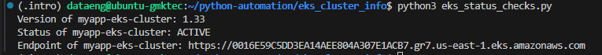

# Automate displaying EKS cluster information

## Overview
This project demonstrates how to use Python and the AWS SDK for Python (Boto3) to automatically query Amazon Elastic Kubernetes Service (EKS) and display key information about deployed clusters.

The script connects to AWS EKS, retrieves all available clusters in the configured AWS account and region, and displays important operational details including the Kubernetes version, cluster status, and API endpoint. Terraform is used to provision and manage the EKS infrastructure, while Python provides a lightweight mechanism for operational monitoring and validation.

## Technologies used
* Python
* Boto3
* AWS EKS
* Terraform

## Project Description
* The Python script performs the following actions:
  - Connects to AWS using Boto3
  - Retrieves a list of EKS clusters
  - Queries each cluster for detailed information
  - Displays:
    - Cluster Name
    - Kubernetes version
    - Cluster status
    - API endpoint URL

## Pre-requisites
* AWS Account
* Terraform
* Python 3.x installed
  ```
    python3 --version
  ```
* Boto3 
* AWS Credentials
  Configure credentials locally using the AWS CLI:
  ```
    aws configure
  ```
  Or by using the environmental variables:
  ```
      export AWS_ACCESS_KEY_ID=<access-key>
      export AWS_SECRET_ACCESS_KEY=<secret-key>
      export AWS_DEFAULT_REGION=us-east-1
  ```
* Required IAM permissions

  The user or role executing the script should have permissions to list and describe clusters in EKS

## Steps

### 1. Provision EKS Infrastructure
Use Terraform to deploy an EKS cluster

Initialize Terraform:
```
  terraform init
```

Review the execution plan:
```
  terraform plan
```

Deploy the infrastructure:
```
  terraform apply
```

### 2. Install Project Dependencies

 Install Boto3
  ```
    python -m venv .venv
    source .venv/bin/activate
    pip install boto3
  ```

### 3. Execute the script
Run the script: 
```
  python3 eks_status_checks.py
```
The script will:
  * Query EKS for all clusters
  * Retrieve detailed information for each cluster
  * Display the Kubernetes version
  * Display the cluster status
  * Display the cluster endpoint.



## Learning outcomes
By completing this project, you will learn how to:
* Use Boto3 to interact with AWS services programmatically.
* Authenticate Python applications with AWS.
* Retrieve and process EKS cluster information.
* Work with AWS APIs using Python.
* Use Terraform to provision Kubernetes infrastructure in AWS.
* Build operational health-check and inventory scripts.
* Understand key EKS cluster attributes such as version, status, and endpoint configuration.
* Integrate infrastructure provisioning and operational validation into an Infrastructure as Code (IaC) workflow.

